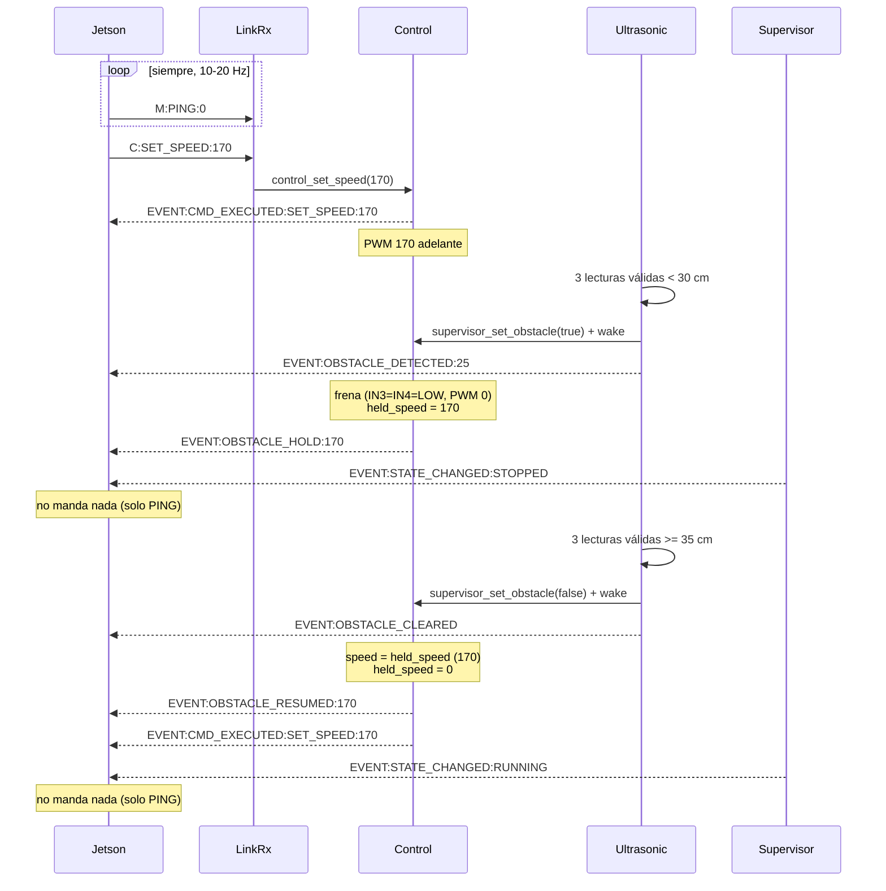

# Protocolo ESP32 ↔ Jetson

Cómo manejar el ESP32 (motor, dirección y ultrasonido) desde la Jetson o una PC.
Fuente de verdad: `src/link_rx_task.cpp` (comandos), `src/supervisor_task.cpp` (estados),
`src/control_task.cpp` (motor y servo), `src/ultrasonic_task.cpp` (obstáculos) e
`include/hardware.h` (valores numéricos).

## Conexión

- **USB**: 115200 baud. En la Jetson la placa aparece como `/dev/ttyCH341USB0`; en una PC, como `/dev/ttyUSB0`.
- **UART externo**: GPIO 17 (TX) / 16 (RX), 921600 baud.
- Los comandos se aceptan por los dos puertos, y **todos los `EVENT:` salen por los dos**.
- **Abrir el puerto reinicia la placa.** Esperá `EVENT:SYSTEM_READY` antes de mandar nada, y asumí que
  cada reconexión arranca de cero: `DISARMED` y nada latcheado. Si el puerto se abre sin reiniciar la
  placa (UART, o USB sin DTR), preguntá el estado con `M:STATUS:0`.

## Formato

```
<CANAL>:<COMANDO>:<VALOR>\n        (\r también sirve como fin de línea)
```

`C` = control, `E` = emergencia, `M` = gestión. El valor es un entero; si el comando no lo usa, mandá `0`.
Se procesan todas las líneas completas que llegan (se revisa cada 10 ms). Una línea de más de 1023
caracteres se descarta entera.

## Estados

```
DISARMED --M:SYS_ARM--> RUNNING <--> STOPPED      (obstáculo o M:SYS_STOP)
    ^                      |            |
    +-----M:SYS_DISARM-----+------------+
cualquiera --E-STOP / watchdog--> FAULT --M:SYS_ARM--> RUNNING
FAULT por watchdog --heartbeat estable 500 ms--> RUNNING (o STOPPED)
```

| Estado | Motor | Servo |
|---|---|---|
| `DISARMED` | frenado, comandos ignorados | centrado |
| `RUNNING` | obedece | obedece |
| `STOPPED` por **obstáculo** | bloquea solo el avance; **la marcha atrás funciona** | obedece |
| `STOPPED` por **`M:SYS_STOP`** | frenado, comandos ignorados | congelado donde estaba |
| `FAULT` | frenado, comandos ignorados | centrado |

- La placa arranca en `DISARMED`. Si se compila con `-DBOOT_ARMED`, arranca en `RUNNING`.
- Cuando el auto frena por `DISARMED`, `FAULT` o `SYS_STOP`, **se borra la velocidad latcheada**. El auto
  no arranca solo: después hace falta un `C:SET_SPEED` nuevo.
- **La única excepción es el obstáculo**: el ESP32 frena, **guarda la velocidad** y, cuando el camino se
  despeja, **retoma solo a esa misma velocidad**, sin que la Jetson mande nada. Ver
  [Caso de uso: freno y reanudación por obstáculo](#caso-de-uso-freno-y-reanudación-por-obstáculo).
- Un `C:SET_SPEED` ignorado por el estado se informa con
  `EVENT:CMD_REJECTED:SET_SPEED:<DISARMED|FAULT|SYS_STOP>` **cada vez que llega una velocidad (o un motivo)
  distinta** de la última rechazada, como mucho una vez cada 200 ms (`REJECT_REPORT_MIN_INTERVAL_MS`). Si
  llega otra dentro de ese intervalo, se informa al terminar, así que la última nunca se pierde. Repetir la
  misma velocidad no genera otro evento. Durante una retención por obstáculo el
  `SET_SPEED` no se rechaza: se guarda como velocidad de reanudación (`EVENT:OBSTACLE_HOLD:<pwm>`).
  Un `C:SET_STEER` ignorado no se informa.
- Al entrar en `STOPPED`, y al mandar `M:SYS_ARM:0` estando en `STOPPED`, llega
  `EVENT:STOPPED_BY:<SYS_STOP|OBSTACLE>`. También llega si la causa cambia sin salir de `STOPPED` (por ejemplo,
  un obstáculo bajo un `SYS_STOP` y después `SYS_RESUME`). Si están las dos, se informa `SYS_STOP`.

### Secuencia de inicio

1. Abrir el puerto y esperar `EVENT:SYSTEM_READY`.
2. Mandar `M:SYS_ARM:0` y esperar `EVENT:CMD_EXECUTED:SYS_ARM`.
3. Mantener vivo el enlace (ver [Watchdog](#watchdog)).

## Comandos

### Control (`C`)

| Comando | Efecto |
|---|---|
| `C:SET_SPEED:<0-255>` | PWM del motor. **Queda latcheado**: un solo comando sostiene la velocidad. `0` frena (IN3=IN4=LOW). Fuera de rango se satura (un negativo da 0). |
| `C:SET_DIR:<0\|1>` | Sentido de marcha: `1` adelante, `0` atrás. Queda latcheado. Si hay una velocidad latcheada, invierte solo. Entre la última vez que el motor anduvo en un sentido y la primera en el contrario pasan siempre al menos 60 ms sin PWM, **aunque en el medio haya frenado** (el motor sigue girando por inercia). |
| `C:SET_STEER:<50-160>` | Ángulo del servo: 50 = izquierda máxima, 105 = centro, 160 = derecha máxima. Fuera de rango se satura. Un ángulo pedido durante `SYS_STOP` se guarda y se aplica al reanudar. |

**Umbral de arranque: 130.** Es el PWM mínimo para que el motor se mueva desde parado (medido en
banco el 2026-11-06 con `scripts/prueba_freno.py`). Con menos, por ejemplo 80, el motor zumba pero no
gira (fricción estática): el firmware lo aplica igual y emite `CMD_EXECUTED:SET_SPEED`, así que el fallo
es silencioso. Hay que mapear el rango útil por encima de ese valor. En el piso, con el auto cargado,
puede hacer falta algo más.

Conversión de grados a valores del servo (el recorrido es simétrico, ±55 alrededor de 105):

```python
def degrees_to_servo(deg, max_deg=45):
    n = max(-1.0, min(1.0, deg / max_deg))
    return int(round(105 + n * 55))   # -45 -> 50, 0 -> 105, +45 -> 160
```

### Emergencia (`E`)

| Comando | Efecto |
|---|---|
| `E:BRAKE_NOW:0` (alias `E:STOP:0`) | Frena en el acto y borra la velocidad latcheada. **Es de un solo uso**: el próximo `C:SET_SPEED` vuelve a mover el auto (ya no hay bloqueo de 5 s). Comparte canal con `SET_SPEED`, así que **decide el orden de llegada**: `SET_SPEED` y después `BRAKE_NOW` termina frenado; al revés, termina andando. Funciona en cualquier estado y no cambia el estado. Para una parada que se mantenga, usá `M:SYS_STOP`. |

### Gestión (`M`)

| Comando | Efecto |
|---|---|
| `M:PING:0` | Solo alimenta el watchdog. No genera respuesta. |
| `M:STATUS:0` | Responde `EVENT:STATUS:<estado>:SYS_STOP=<0\|1>:OBSTACLE=<0\|1>:SPEED=<pwm>:HELD=<pwm>:ULTRASONIC=<OK\|SILENT\|FAULT>`: el estado, si el `SYS_STOP` está enganchado, si hay una parada por obstáculo, la velocidad latcheada, la guardada para retomar tras el obstáculo (`0` = ninguna) y la salud del ultrasonido (ver [Obstáculos](#obstáculos)). Sirve para leer el estado real al conectarse sin depender de que la placa se reinicie. Alimenta el watchdog. |
| `M:SYS_ARM:0` | `DISARMED`/`FAULT` → `RUNNING` (o `STOPPED`, si hay una parada activa). Siempre confirma con `CMD_EXECUTED:SYS_ARM`, aunque ya estuviera armado. Con el E-STOP accionado responde `CMD_REJECTED:SYS_ARM:ESTOP_ACTIVE`. Se aplica en ≤ 20 ms. `SYS_ARM` y `SYS_DISARM` se procesan **en orden de llegada**, aunque lleguen en el mismo ciclo. |
| `M:SYS_DISARM:0` | → `DISARMED`: frena y centra el servo. La velocidad se borra en el acto, sin esperar al supervisor. Siempre confirma con `CMD_EXECUTED:SYS_DISARM`. |
| `M:SYS_STOP:0` | Parada enganchada: `STOPPED`, motor frenado (en los dos sentidos) y servo congelado. **Solo la suelta `M:SYS_RESUME:0`**: sobrevive a `DISARM`, `FAULT` y a volver a armar. Un reinicio de la placa la borra. Siempre confirma con `CMD_EXECUTED:SYS_STOP`. |
| `M:SYS_RESUME:0` | Suelta el `SYS_STOP`. No reanuda nada solo: hace falta un `C:SET_SPEED` nuevo. Si hay un obstáculo, el auto sigue en `STOPPED`. Siempre confirma con `CMD_EXECUTED:SYS_RESUME`. |
| `M:OBSTACLE_RESET:0` | Suelta la parada por obstáculo (ver [Obstáculos](#obstáculos)). Si el obstáculo sigue ahí, en ~150 ms se vuelve a bloquear. **Borra la velocidad guardada**: después de un reset el auto no retoma solo, hace falta un `C:SET_SPEED` nuevo. Siempre confirma con `CMD_EXECUTED:OBSTACLE_RESET`. |

Cualquier otro comando (incluido el viejo `M:LIGHTS_*`) se ignora, queda registrado como
`[LinkRx] unknown command` y **no alimenta el watchdog**.

## Watchdog

Si durante más de **300 ms** (`WATCHDOG_TIMEOUT_MS`) no llega ningún comando reconocido, el auto
entra en `FAULT`: frena, centra el servo y borra la velocidad. Esto se controla en `RUNNING` y en
`STOPPED`.

- Mandá algún comando reconocido a **10–20 Hz**. Puede ser `M:PING:0` o los propios comandos de control.
- Contando el período de revisión y la separación entre pings, el corte real ocurre a unos **350–370 ms**
  del último comando.
- Arranca a contar con el primer comando. `SYS_ARM` lo reinicia. Funciona igual cuando el contador de ticks
  de 32 bits da la vuelta (~49,7 días).
- Un `FAULT` **por watchdog se borra solo**: si el heartbeat vuelve y se mantiene estable **500 ms**
  (`WATCHDOG_RECOVERY_MS`; estable = sin huecos de más de 300 ms), llega `EVENT:WATCHDOG_RECOVERED` y el auto
  vuelve a `RUNNING` (o a `STOPPED`, si hay una parada activa) **con la velocidad en 0**. Un `C:SET_SPEED`
  mandado durante el `FAULT` no cuenta: hace falta uno nuevo. También se puede salir antes con `M:SYS_ARM:0`.
- Un `FAULT` **por E-STOP no se borra solo**, aunque se suelte el botón y el enlace esté vivo: hay que mandar
  `M:SYS_ARM:0`. Si se acciona el E-STOP durante un `FAULT` por watchdog, pasa a contar como E-STOP.
- En los dos casos el servo queda centrado, así que reenviá también el ángulo.

## Obstáculos

El ultrasonido (HC-SR04) se lee cada ~60–80 ms. El eco se mide con una interrupción en los dos flancos, y
la tarea duerme mientras espera (hasta 30 ms), sin ocupar el core del control. Con `-DULTRASONIC_USE_PULSEIN`
se vuelve a `pulseIn()`. Para **frenar solo cuentan las lecturas válidas** (de 2 a 400 cm): una lectura
sin eco o fuera de rango **no frena y no corta una cuenta** (un objeto muy cerca o una superficie blanda
también pueden perder el eco). Si el pulso de ECHO de la lectura anterior sigue en alto (sin eco, el
HC-SR04 lo deja en alto ~38 ms y algunos clones ~200 ms), se espera a que baje y 20 ms más antes de
disparar de nuevo.

- **Frena** con 3 lecturas válidas seguidas **< 30 cm** → `EVENT:OBSTACLE_DETECTED:<cm>` → `STOPPED`.
- **Despeja** con 3 lecturas válidas seguidas **≥ 35 cm** → `EVENT:OBSTACLE_CLEARED` → `RUNNING`.
- "Seguidas" se cuenta entre lecturas válidas: una válida del tipo contrario reinicia la cuenta. Además,
  **la evidencia vence**: si pasa más de 1 s entre dos lecturas válidas de una cuenta, la cuenta empieza de
  nuevo. Así, tres lecturas falsas espaciadas no suman una parada.
- La franja de 30 a 34 cm es histéresis, para que un objeto justo en el límite no haga oscilar el freno.
- **Solo se bloquea el avance** (el sensor mira hacia adelante; si se monta atrás, se compila con
  `-DULTRASONIC_FACING_FORWARD=0`). Con un obstáculo delante se puede retroceder, y el servo obedece.
- Al frenar, el ESP32 **guarda la velocidad** que tenía y, al despejarse, **retoma solo** a esa velocidad
  (`EVENT:OBSTACLE_HOLD:<pwm>` al frenar, `EVENT:OBSTACLE_RESUMED:<pwm>` al retomar). La Jetson no tiene
  que reenviar nada. Detalle y casos borde en
  [Caso de uso: freno y reanudación por obstáculo](#caso-de-uso-freno-y-reanudación-por-obstáculo).
- **Despeja también en espacio abierto**: si se saca el obstáculo y no queda nada dentro del alcance, no
  llegan lecturas lejanas válidas, pero el sensor sigue disparando (ECHO sube) y no vuelve eco. **2 s
  seguidos** de lecturas sin eco o lejanas (al menos 5) → `EVENT:OBSTACLE_CLEARED` (y retoma solo). Una
  lectura cerca (< 35 cm o < 2 cm), una lectura en que el sensor no disparó (ECHO nunca subió: sin
  alimentación, cable suelto) o ECHO trabado en alto cortan ese tramo: **un sensor muerto nunca suelta el
  freno**. `M:OBSTACLE_RESET:0` sigue sirviendo para soltarlo al instante (pero no retoma solo: hay que
  reenviar la velocidad).
- Latencia medida en el simulador, desde la primera lectura cercana hasta el PWM en 0: ~120 ms con un
  sensor limpio. Con pérdida de ecos crece (porque hacen falta 3 lecturas válidas): ~150 ms con 50% de
  pérdida, ~315 ms con 75% y ~1 s con 90%.

Salud del sensor (eventos **informativos**, nunca frenan):
- `EVENT:ULTRASONIC_SILENT`: 2 s sin ninguna lectura válida. Puede ser espacio abierto o un sensor
  desconectado; para saber cuál, mirá `ULTRASONIC_FAULT`.
- `EVENT:ULTRASONIC_OK`: volvió a llegar una lectura válida.
- `EVENT:ULTRASONIC_FAULT:<NO_RESPONSE|STUCK_HIGH>`: **el sensor no está funcionando**. Durante 1 s
  (`ULTRASONIC_FAULT_MS`) ninguna lectura lo mostró disparando: `NO_RESPONSE` = ECHO nunca subió (sin
  alimentación, TRIG o ECHO suelto, sensor muerto), `STUCK_HIGH` = ECHO quedó trabado en alto. **Mientras
  dure, no hay protección ante obstáculos**: el ESP32 no frena por algo que no ve. Tampoco suelta un bloqueo
  que ya estaba (ver arriba). Qué hacer (frenar, ir más despacio, avisar) lo decide la Jetson.
- `EVENT:ULTRASONIC_RECOVERED`: el sensor volvió a disparar (una lectura válida, sin eco o fuera de
  rango).

Un sensor muerto termina en `FAULT` y también en `SILENT`; el espacio abierto queda solo en `SILENT`. Una
lectura suelta sin flanco no alcanza para el `FAULT`. Límite: si ECHO sube pero el receptor no recibe nada,
para el firmware es espacio abierto. `M:STATUS:0` informa el estado actual en `ULTRASONIC=` (`FAULT` gana
sobre `SILENT`), para quien se conecta después de que salió el evento.

En el banco, cualquier cosa a menos de 30 cm (una pared, una caja, una mano) frena el auto.

## Eventos

Toda línea que empieza con `EVENT:` es protocolo. Lo demás (`[Control] ...`, `[Supervisor] ...`, etc.) es
depuración: sale solo por USB y no hay que parsearlo. Cada línea llega entera (se escribe de una sola vez
bajo un mutex) y se trunca a ~157 caracteres.

| Evento | Cuándo |
|---|---|
| `EVENT:SYSTEM_READY` | Terminó el arranque |
| `EVENT:STATE_CHANGED:<DISARMED\|RUNNING\|STOPPED\|FAULT>` | Cambio de estado (al arrancar se informa el inicial) |
| `EVENT:CMD_EXECUTED:SET_SPEED:<pwm>` | Cambió la velocidad latcheada (valor ya saturado; un freno produce `SET_SPEED:0`) |
| `EVENT:CMD_REJECTED:SET_SPEED:<DISARMED\|FAULT\|SYS_STOP>` | Un `SET_SPEED` > 0 ignorado por el estado (cada velocidad distinta, como mucho cada 200 ms) |
| `EVENT:STOPPED_BY:<SYS_STOP\|OBSTACLE>` | Motivo de `STOPPED`: al entrar, al armar estando en `STOPPED` y si cambia |
| `EVENT:STATUS:<estado>:SYS_STOP=<0\|1>:OBSTACLE=<0\|1>:SPEED=<pwm>:HELD=<pwm>:ULTRASONIC=<OK\|SILENT\|FAULT>` | Respuesta a `M:STATUS:0` |
| `EVENT:CMD_EXECUTED:SET_STEER:<ángulo>` | El servo se movió (incluye el centrado, como `SET_STEER:105`) |
| `EVENT:CMD_EXECUTED:BRAKE_NOW` | Se aplicó `E:BRAKE_NOW` / `E:STOP` |
| `EVENT:CMD_EXECUTED:<SYS_ARM\|SYS_DISARM\|SYS_STOP\|SYS_RESUME\|OBSTACLE_RESET>` | Se aplicó el comando. Siempre se confirma, aunque no haya cambiado nada |
| `EVENT:CMD_REJECTED:SYS_ARM:ESTOP_ACTIVE` | Intento de armar con el E-STOP accionado |
| `EVENT:ESTOP_TRIGGERED:GPIO` / `EVENT:ESTOP_RELEASED` | E-STOP físico (GPIO 4, activo en bajo) |
| `EVENT:WATCHDOG_TIMEOUT` | Pérdida de enlace → `FAULT` |
| `EVENT:WATCHDOG_RECOVERED` | El heartbeat volvió estable 500 ms → `RUNNING`/`STOPPED`, velocidad en 0 |
| `EVENT:OBSTACLE_DETECTED:<cm>` / `EVENT:OBSTACLE_CLEARED` | Ver [Obstáculos](#obstáculos) |
| `EVENT:OBSTACLE_HOLD:<pwm>` | El obstáculo frenó el auto y el ESP32 guardó `<pwm>` para retomar. Se repite si la velocidad guardada cambia durante el bloqueo; `0` = ya no va a retomar solo |
| `EVENT:OBSTACLE_RESUMED:<pwm>` | Se despejó el obstáculo y el auto retomó solo a `<pwm>` (le sigue `CMD_EXECUTED:SET_SPEED:<pwm>`) |
| `EVENT:ULTRASONIC_SILENT` / `EVENT:ULTRASONIC_OK` | Salud del sensor (informativo): sin lecturas válidas, por espacio abierto o sensor muerto |
| `EVENT:ULTRASONIC_FAULT:<NO_RESPONSE\|STUCK_HIGH>` / `EVENT:ULTRASONIC_RECOVERED` | El sensor no dispara: sin protección ante obstáculos (informativo, no frena) |
| `EVENT:FATAL:TASK_CREATE_FAILED:<tarea>` | Falla de arranque; la placa se reinicia |

Ya no existen `CMD_RECEIVED:*`, `STATE_AUTO_TRANSITION:*`, `SET_STEER_CENTER`, `EMERGENCY_BRAKE`,
`LIGHTS_*` ni el estado `ARMED`.

## Caso de uso: freno y reanudación por obstáculo

El ESP32 maneja solo el freno por obstáculo **y la vuelta a la marcha**. La Jetson manda la velocidad una
vez y después solo escucha.

1. La Jetson manda `C:SET_SPEED:170` → el ESP32 va a 170 de PWM.
2. El ultrasonido ve algo a menos de 30 cm → el ESP32 frena por su cuenta.
3. El ESP32 avisa que está frenado por obstáculo. La Jetson no hace nada.
4. El ultrasonido deja de ver algo cerca → el ESP32 retoma solo a 170, la velocidad que tenía antes.
5. El ESP32 avisa que retomó la marcha. La Jetson no hace nada.

"No hace nada" quiere decir que no reenvía comandos de movimiento. **El heartbeat sigue siendo obligatorio**
(`M:PING:0` a 10–20 Hz): si se corta más de 300 ms el auto entra en `FAULT` y se pierde la velocidad guardada.

### Mensajes que intervienen

Jetson → ESP32 (una línea por comando, terminada en `\n`):

| Línea | Uso en el caso |
|---|---|
| `M:SYS_ARM:0` | Armar, una vez al conectar |
| `C:SET_DIR:1` | Adelante (hacia el sensor) |
| `C:SET_SPEED:170` | Velocidad crucero. Queda latcheada |
| `M:PING:0` | Heartbeat, a 10–20 Hz durante todo el caso |

ESP32 → Jetson (salen por USB y UART, terminadas en `\r\n`):

| Línea | Paso | Quién la emite |
|---|---|---|
| `EVENT:CMD_EXECUTED:SET_SPEED:170` | 1 | `control_task.cpp` |
| `EVENT:OBSTACLE_DETECTED:<cm>` | 3 | `ultrasonic_task.cpp` |
| `EVENT:OBSTACLE_HOLD:170` | 3: frenado por obstáculo, guardó 170 | `control_task.cpp` |
| `EVENT:STATE_CHANGED:STOPPED` | 3 | `supervisor_task.cpp` |
| `EVENT:OBSTACLE_CLEARED` | 5 | `ultrasonic_task.cpp` |
| `EVENT:OBSTACLE_RESUMED:170` | 5: retomó la marcha a 170 | `control_task.cpp` |
| `EVENT:CMD_EXECUTED:SET_SPEED:170` | 5 | `control_task.cpp` |
| `EVENT:STATE_CHANGED:RUNNING` | 5 | `supervisor_task.cpp` |

El orden dentro de cada grupo es el típico, no está garantizado: `Control`/`Ultrasonic` corren en el core 0
y `Supervisor` en el core 1 (cada 20 ms). La Jetson tiene que tratar cada evento por separado. Para saber si
el auto está frenado o en marcha, lo que manda es `OBSTACLE_HOLD` / `OBSTACLE_RESUMED`; `OBSTACLE_DETECTED`
también aparece cuando el auto ya estaba quieto o iba marcha atrás, y en ese caso no hay `OBSTACLE_HOLD`.

### Diagrama de secuencia



Versión en texto:

```
Jetson                         ESP32
  |-- C:SET_SPEED:170 -------->|  PWM 170
  |<-- CMD_EXECUTED:SET_SPEED:170
  |                            |  ultrasonido: 3 válidas < 30 cm
  |<-- OBSTACLE_DETECTED:25 ---|  frena, guarda 170
  |<-- OBSTACLE_HOLD:170 ------|
  |<-- STATE_CHANGED:STOPPED --|
  |   (solo M:PING:0)          |  ultrasonido: 3 válidas >= 35 cm
  |<-- OBSTACLE_CLEARED -------|  retoma a 170
  |<-- OBSTACLE_RESUMED:170 ---|
  |<-- CMD_EXECUTED:SET_SPEED:170
  |<-- STATE_CHANGED:RUNNING --|
```

### Máquinas de estado

Ultrasonido (`src/ultrasonic_task.cpp`; solo cuentan lecturas válidas):

```
LIBRE --3 válidas < 30 cm--> BLOQUEADO      (EVENT:OBSTACLE_DETECTED:<cm>)
BLOQUEADO --3 válidas >= 35 cm--> LIBRE     (EVENT:OBSTACLE_CLEARED)
BLOQUEADO --2 s sin eco o lejos (>= 5 lecturas)--> LIBRE   (EVENT:OBSTACLE_CLEARED; un sensor muerto no cuenta)
BLOQUEADO --M:OBSTACLE_RESET:0--> LIBRE     (EVENT:CMD_EXECUTED:OBSTACLE_RESET + EVENT:OBSTACLE_CLEARED)
```

Motor (`src/control_task.cpp`). `speed` es la velocidad latcheada, `held_speed` la guardada para retomar:

```
                 C:SET_SPEED:v (v>0)
  QUIETO (speed=0) -------------------> EN MARCHA (speed=v)
        ^                                    |
        | DISARM / FAULT / SYS_STOP /        | obstáculo y sentido hacia el sensor
        | BRAKE_NOW / SET_SPEED:0 /          v
        | OBSTACLE_RESET           RETENIDO POR OBSTÁCULO (speed=0, held_speed=v)
        +-------------------------------- |  ^   EVENT:OBSTACLE_HOLD:v
                                           |  |   C:SET_SPEED:w -> held_speed=w (OBSTACLE_HOLD:w)
                                           |  +-- (0 cancela: OBSTACLE_HOLD:0, ya no retoma)
            obstáculo despejado            v
            EVENT:OBSTACLE_RESUMED:v --> EN MARCHA (speed=held_speed)
```

El estado del sistema (`DISARMED`/`RUNNING`/`STOPPED`/`FAULT`, ver [Estados](#estados)) acompaña:
`RUNNING` → `STOPPED` al bloquear y `STOPPED` → `RUNNING` al despejar.

### Casos borde

| Situación | Qué hace el ESP32 |
|---|---|
| La Jetson manda `C:SET_SPEED:w` (w>0) mientras está retenido | No se mueve. Guarda `w` como nueva velocidad de reanudación y emite `EVENT:OBSTACLE_HOLD:w` (solo si cambió: reenviar 170 cada 50 ms no genera eventos). Al despejar retoma a `w`. |
| La Jetson manda `C:SET_SPEED:0` o `E:BRAKE_NOW:0` mientras está retenido | Borra la velocidad guardada → `EVENT:OBSTACLE_HOLD:0` (más `CMD_EXECUTED:BRAKE_NOW` si fue un freno). Al despejar **no** retoma. |
| El auto estaba quieto (speed 0) cuando apareció el obstáculo | Solo `OBSTACLE_DETECTED` y `STATE_CHANGED:STOPPED`. No hay nada que retomar. |
| Obstáculo con el auto **marcha atrás** (`SET_DIR:0`) | El bloqueo es solo hacia adelante: sigue retrocediendo, no hay `OBSTACLE_HOLD` ni velocidad guardada. |
| Retenido y la Jetson manda `C:SET_DIR:0` (retroceder) | El auto no arranca hacia atrás solo: queda quieto y **se descarta la velocidad guardada**. Para alejarse hace falta un `C:SET_SPEED` nuevo, que se aplica marcha atrás. Al volver adelante no retoma solo. |
| `M:OBSTACLE_RESET:0` | Suelta el bloqueo y **borra la velocidad guardada** (`OBSTACLE_HOLD:0` si seguía retenido): un reset manual nunca arranca el auto solo, porque el obstáculo puede seguir ahí. Hay que mandar `C:SET_SPEED` de nuevo. |
| `M:SYS_STOP:0` mientras está retenido | Gana el `SYS_STOP`: se borra la velocidad guardada. Después de `M:SYS_RESUME:0` hace falta un `C:SET_SPEED`. |
| `M:SYS_DISARM:0`, E-STOP o watchdog (`FAULT`) mientras está retenido | Se borra la velocidad guardada. Al volver a armar hace falta un `C:SET_SPEED`. |
| Se saca el obstáculo y no queda nada dentro del alcance (solo lecturas sin eco) | Tras **2 s seguidos** sin eco o lejos (al menos 5 lecturas) se emite `EVENT:OBSTACLE_CLEARED` y el auto **retoma solo** a la velocidad guardada (`EVENT:OBSTACLE_RESUMED:<pwm>`). Si el sensor no responde (ECHO nunca sube) o queda trabado en alto, sigue `BLOQUEADO`. |
| `C:SET_STEER` mientras está retenido | El servo obedece (el obstáculo no congela la dirección). |
| Velocidad guardada por debajo de 130 | Se retoma igual, pero con menos de 130 de PWM el motor no arranca desde parado (ver [Control](#control-c)). |

## Ejemplo mínimo

```python
import serial, threading, time

ser = serial.Serial("/dev/ttyCH341USB0", 115200, timeout=1)   # /dev/ttyUSB0 en una PC
while b"EVENT:SYSTEM_READY" not in ser.readline():            # abrir el puerto reinicia la placa
    pass

def heartbeat():
    while True:
        ser.write(b"M:PING:0\n")
        time.sleep(0.05)                                      # 20 Hz < watchdog de 300 ms
threading.Thread(target=heartbeat, daemon=True).start()

ser.write(b"M:SYS_ARM:0\n")
ser.write(b"C:SET_DIR:1\n")
ser.write(b"C:SET_SPEED:180\n")     # velocidad crucero: queda latcheada
ser.write(b"C:SET_STEER:90\n")
time.sleep(2)
ser.write(b"M:SYS_STOP:0\n")        # stop enganchado
time.sleep(1)
ser.write(b"M:SYS_RESUME:0\n")      # start: suelta el stop...
ser.write(b"C:SET_SPEED:180\n")     # ...y hay que volver a mandar la velocidad
```

## Clientes conocidos

- **AURA-2026** (`brain/command_sender.py`, `brain/dashboard/dashboard_server.py`): manda `M:PING` a 20 Hz y arma al
  recibir `SYSTEM_READY`. Al recibir un `OBSTACLE_CLEARED` que termina un bloqueo, reenvía la última velocidad
  (no lo hace después de un `OBSTACLE_RESET`). Al armar, reenvía el ángulo. Con `FAULT`, `DISARMED` o un
  reinicio de la placa olvida la última velocidad y cancela lo que tengan programado las estrategias; lo mismo
  hacen el freno y el stop del dashboard. Tiene un botón para `OBSTACLE_RESET`. No vuelve a armar solo después de
  un `FAULT` (ahora el firmware sale solo de un `FAULT` por watchdog). Todavía no usa `STOPPED_BY`,
  `WATCHDOG_RECOVERED`, `M:STATUS` ni `ULTRASONIC_FAULT`. Desde que el firmware retoma solo, el reenvío de velocidad tras `OBSTACLE_CLEARED` es redundante
  pero inofensivo (llega un `SET_SPEED` con el mismo valor que ya se está aplicando).
- **`bfmc_hardware_bridge`** (ROS2): arma al conectar y manda `SET_STEER` + `SET_SPEED` a 20 Hz. Todavía no usa
  `ULTRASONIC_FAULT`.

## Configuración compartida con Brain-Aura

Los valores que los dos lados tienen que ver iguales (topes del servo, watchdog, pines) se pueden definir en
`Brain-Aura/hardware.env`:

```
# firmware: SERVO_LEFT
BRAIN_SERVO_IZQUIERDA=50
```

`scripts/hardware_env.py` lee ese archivo antes de compilar y emite `-DSERVO_LEFT=50`. Los `#define` de
`include/hardware.h` están envueltos en `#ifndef`, así que gana lo del archivo; si alguno no está envuelto,
el script corta la compilación. Además, se comprueba al compilar que `SERVO_LEFT < SERVO_CENTER <
SERVO_RIGHT` y que el watchdog sea mayor que `LINK_EXPECTED_PERIOD_MS`. Cambiar cualquiera de estos valores
exige recompilar y volver a flashear.
